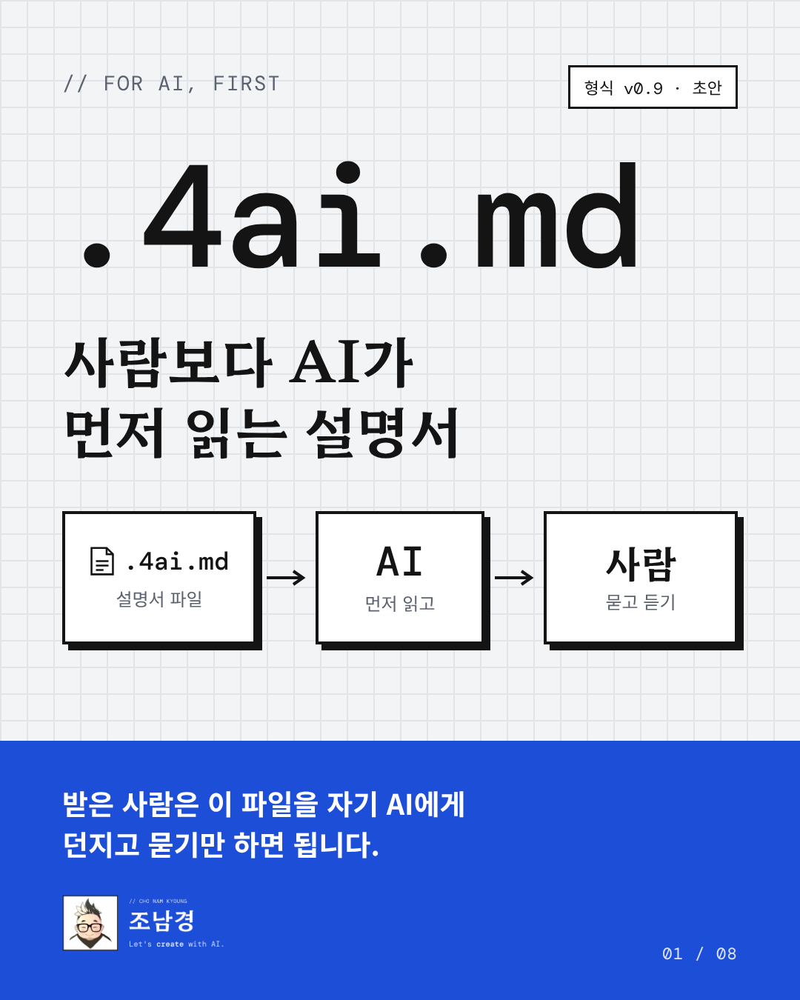
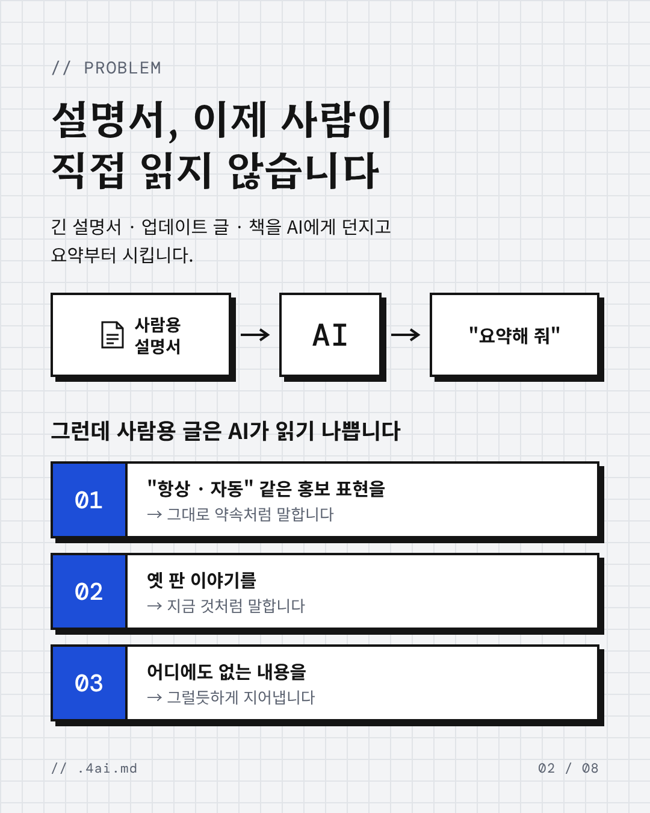
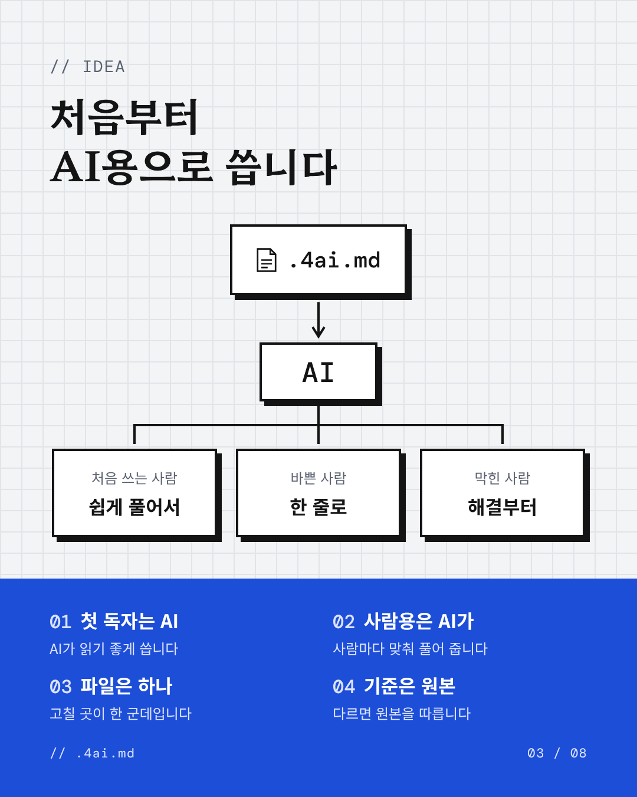
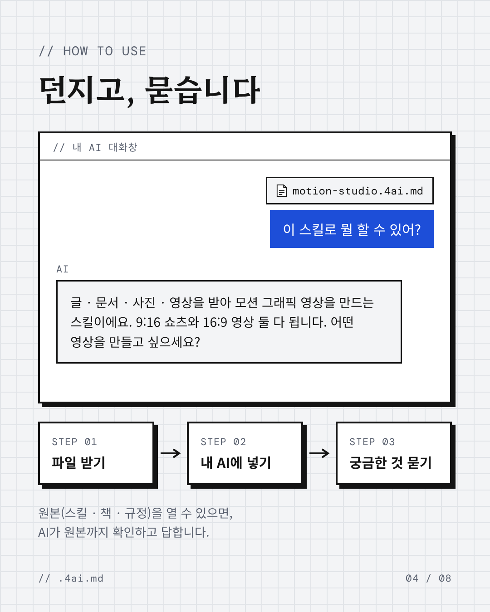
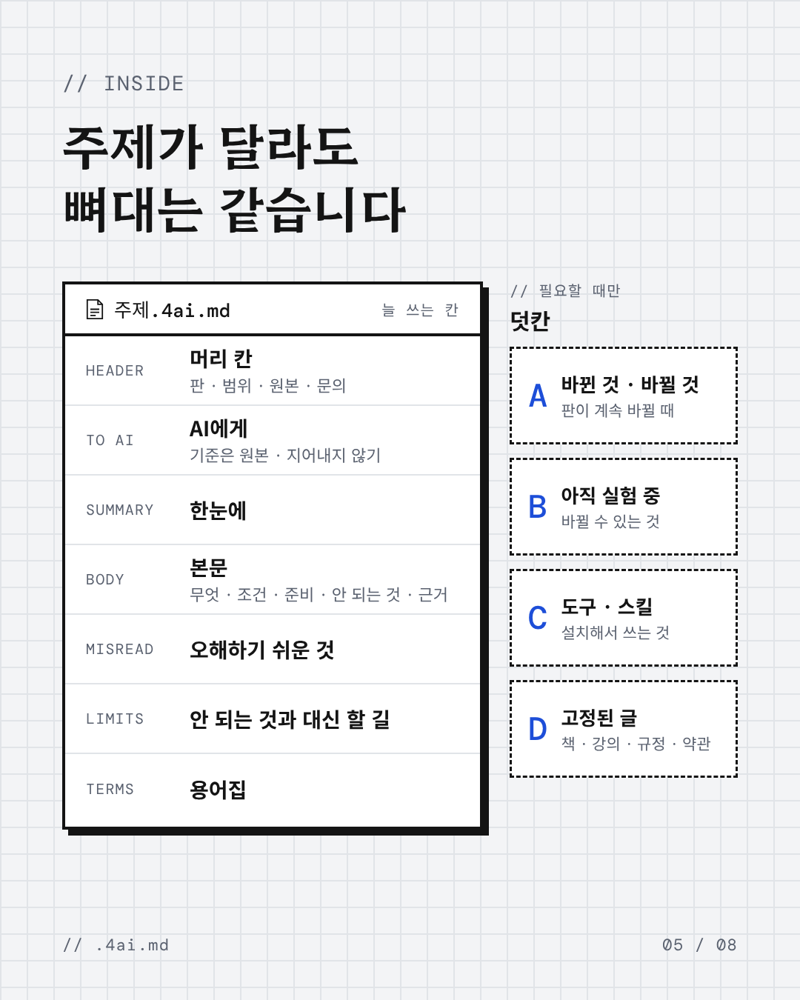
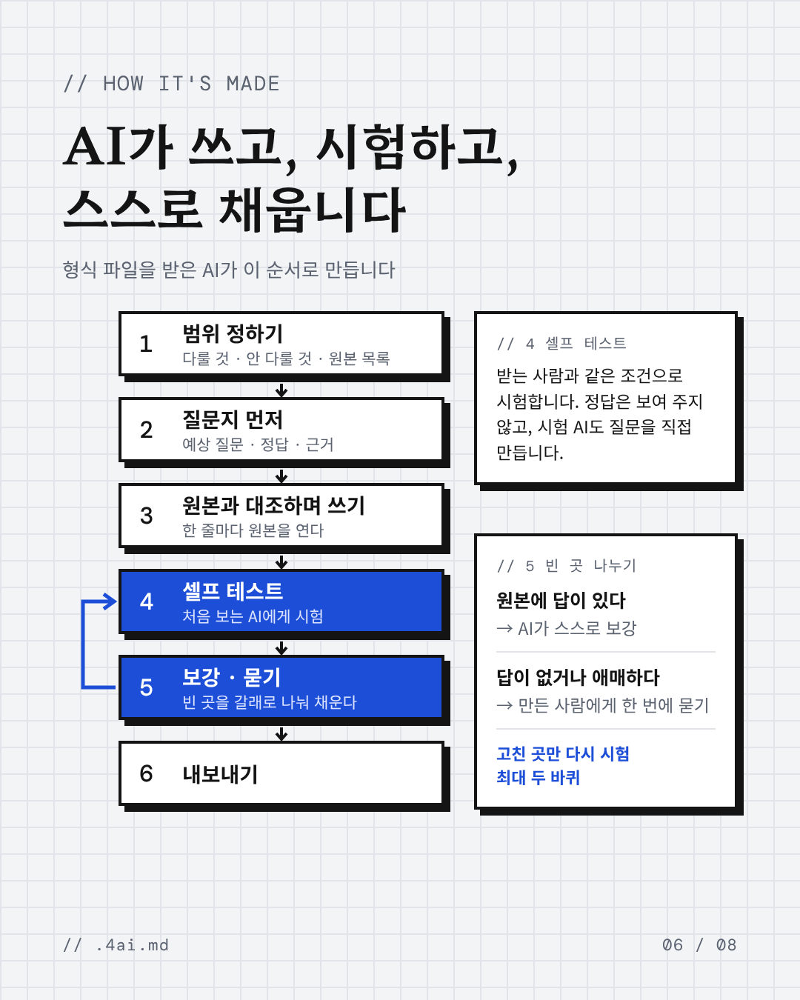
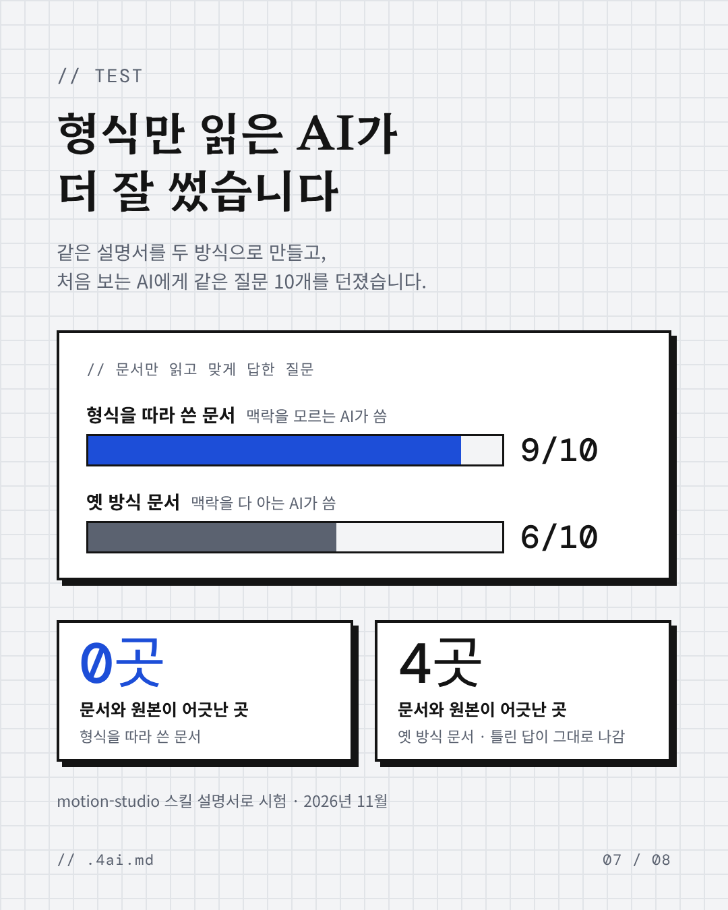
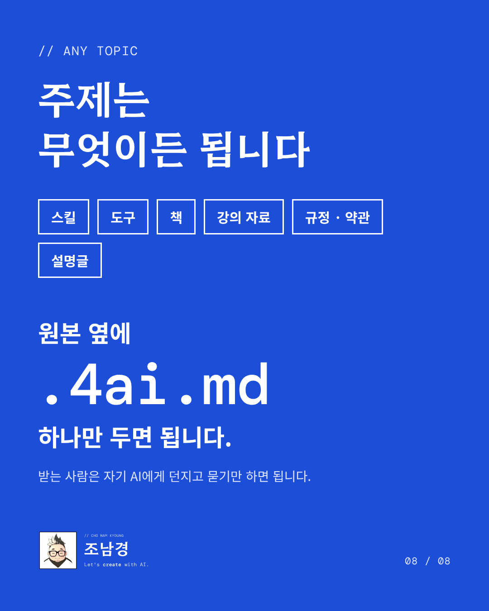

<h1 align="center">.4ai.md</h1>

<p align="center">
  사람보다 AI가 먼저 읽는 설명서 형식<br>
  <sub>초안 v0.9 · 제안 단계 · <a href="#english">English</a></sub>
</p>

---

`.4ai.md` 는 도구 · 스킬 · 책 · 규정 같은 **원본 하나를 AI가 사람에게 설명할 수 있게 쓴 문서**입니다.
받는 사람은 이 파일을 자기 AI에게 던지고 물어보기만 하면 됩니다.

이 저장소는 그 형식을 제안하고, 형식 문서와 예시를 함께 제공합니다.

## 카드로 먼저 보기

<table>
  <tr>
    <td width="50%"></td>
    <td width="50%"></td>
  </tr>
  <tr>
    <td width="50%"></td>
    <td width="50%"></td>
  </tr>
  <tr>
    <td width="50%"></td>
    <td width="50%"></td>
  </tr>
  <tr>
    <td width="50%"></td>
    <td width="50%"></td>
  </tr>
</table>

## 파일

| 파일 | 무엇 |
|---|---|
| [`FORMAT.md`](FORMAT.md) | 형식 문서 — .4ai.md 를 쓸 때 따르는 규칙(만드는 법 + 문서 틀). AI에게 맡겨도, 사람이 따라도 됩니다 |
| [`4ai-format.4ai.md`](4ai-format.4ai.md) | 예시 — 이 형식 자체를 이 형식으로 설명한 문서. AI에게 던지고 "4ai.md 가 뭐야?"라고 물어보세요 |
| [`cards/`](cards) | 위 개념 카드 8장 |

## 왜 만들었나


사람들은 이미 설명서 · 업데이트 글 · 책을 직접 읽지 않고 AI에게 요약을 시킵니다. 그런데 사람용으로 쓴 글은 AI가 읽기에 나쁩니다. 홍보 표현은 약속처럼 전해지고, 옛 판 이야기는 지금 것처럼 전해지고, 없는 내용은 지어내게 됩니다.

그래서 처음부터 AI용으로 씁니다. 첫 독자는 AI이고, 사람에게 맞춘 정리는 AI가 그 사람에 맞춰 풀어 줍니다. 사람용 글을 따로 관리하지 않고, 기준은 늘 원본입니다.

## 받는 사람 — 던지고, 묻습니다


`.4ai.md` 파일을 받으면 자기 AI(Claude · ChatGPT 등)에게 넣고 궁금한 것을 묻습니다. 형식을 몰라도 됩니다. 문서마다 앞부분에 받는 AI를 위한 "AI에게" 절이 있어서, 처음 보는 AI도 그 안내를 따라 답합니다. 원본을 열 수 있으면 AI가 필요할 때 원본을 열어 보고, 문서와 원본이 다르면 원본을 따릅니다.

## 쓰는 사람 — AI가 쓰고, 시험하고, 스스로 채웁니다


`FORMAT.md` 와 원본(스킬 파일 · 원고 · 규정집 등)을 AI에게 주고 이렇게 말하면 됩니다.

```
FORMAT.md 형식대로 [주제].4ai.md 를 만들어 줘.
1부 만드는 법 ①~⑥ 순서대로, 셀프 테스트와 보강까지 해 줘.
```

AI는 범위를 정하고, 질문지를 먼저 만들고, 원본과 대조하며 씁니다. 그다음 문서를 처음 보는 AI로 셀프 테스트를 하고, 빈 곳을 나눠 채웁니다. 원본에 답이 있으면 스스로 보강하고, 답이 없거나 애매하면 원본을 만든 사람에게 **한 번에 모아서** 묻습니다. 원본끼리 말이 다른 곳은 따로 알립니다.

셀프 테스트에는 맥락을 모르는 AI가 필요합니다. 서브 에이전트를 쓸 수 있는 환경(Claude Code · Cowork 등)이 가장 편합니다. 쓸 수 없을 때 대신하는 방법은 `FORMAT.md` ④에 순서대로 있습니다.

## 시험해 본 결과


같은 스킬 설명서를 두 방식으로 만들고, 처음 보는 AI에게 같은 질문 10개를 던졌습니다. 형식만 읽은 AI가 쓴 문서는 문서만으로 9개에 답했고 원본과 어긋난 곳이 없었습니다. 맥락을 다 아는 AI가 옛 방식으로 쓴 문서는 6개에 답했고, 어긋난 곳 4곳 중 하나는 틀린 답으로 그대로 사람에게 전해졌습니다.

시험은 아직 한 주제 · 한 번입니다. 다른 주제로 써 보면서 형식을 계속 고쳐 갑니다.

## 주제는 무엇이든


스킬 · 도구 · 책 · 강의 자료 · 규정 · 약관 · 일반 설명글 모두 같은 뼈대를 씁니다. 주제에 따라 필요한 덧칸(바뀐 것 · 실험 중 · 도구 · 고정된 글)만 붙입니다.

## 비슷한 것과 다른 점

- `llms.txt` — 웹사이트를 AI에게 소개하는 파일
- `AGENTS.md` — 코딩 에이전트에게 저장소에서 일하는 법을 알려 주는 파일
- `.4ai.md` — 원본 하나(도구 · 책 · 규정 등)를 **AI가 사람에게 설명하게 돕는** 문서

## 지금 상태

초안 v0.9, 제안 단계입니다. v0.9 가 첫 공개판이고, 써 보며 고쳐 가는 중이라 판이 바뀔 수 있습니다. 이 형식으로 만든 문서를 모아 두는 곳은 아직 없습니다. 써 보신 경험이나 막힌 곳은 [Issues](https://github.com/nk-mjk/4ai-md/issues)에 남겨 주세요.

만든 사람: 조남경 (Cho Nam Kyoung)

---

<a id="english"></a>

## English

**`.4ai.md` is a doc format that AI reads first.** It describes one source — a tool, a skill, a book, a policy — so that an AI can explain it to a person. Whoever receives a `.4ai.md` file just hands it to their own AI and asks questions.

**Why.** People already skip manuals and release notes and ask an AI to summarize them. But text written for humans reads badly for AI: marketing phrases turn into promises, old-version details are told as current, and gaps get filled with made-up answers. So we write for the AI first, let the AI tailor it for each person, skip maintaining a separate human version, and always treat the source as the ground truth.

**For readers.** Give the `.4ai.md` file to your AI and ask. You don't need to know the format: every file has a "To the AI" section near the top that tells a first-time AI how to use it. If the source can be opened, the AI opens it when needed and follows the source when the two differ.

**For writers.** Give [`FORMAT.md`](FORMAT.md) and your source to an AI and ask it to build `[topic].4ai.md` following Part 1. The AI scopes the doc, writes a question list first, writes against the source line by line, self-tests with a fresh AI that has no prior context, then fills gaps: it fixes what the source already answers, asks the source's creator everything else **in one batch**, and flags places where sources disagree.

**First test.** The same skill manual was written two ways and tested with 10 identical questions on a fresh AI. The doc written by an AI that only read the format answered 9/10 from the doc alone with 0 mismatches against the source; the doc written the old way by an AI with full context answered 6/10, with 4 mismatches — one of which reached the user as a wrong answer. One topic, one run so far.

**Files.** `FORMAT.md` (the format, in Korean) · `4ai-format.4ai.md` (this format explained in its own format — hand it to your AI and ask "what is 4ai.md?") · `cards/` (the concept cards at the top, in Korean).

**Status.** Draft v0.9, a proposal — v0.9 is the first public version. Feedback is welcome in [Issues](https://github.com/nk-mjk/4ai-md/issues).

## License

[CC BY 4.0](LICENSE) — 출처를 밝히면 누구나 쓰고 고치고 나눌 수 있습니다. Free to use, adapt and share with attribution.
